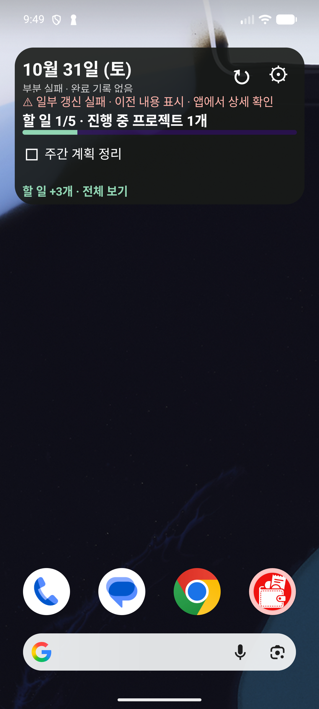

# Android 위젯 개선판 검증 기록

작성일: 2026-11-01 (KST)

## 결과 요약

- `android/`에서 `gradlew.bat test assembleDebug lintDebug --console=plain` 실행: **BUILD SUCCESSFUL**.
- JUnit 단위 테스트 **69개 통과, 실패 0개**. `lintDebug`도 성공했다.
- Pixel 6a 에뮬레이터에서 2×2·4×2·4×4와 설정 홈·꾸미기·위젯 추가 미리보기를 실제 렌더링했다. 다크 모드·150% 글씨·90% 배경 불투명도 조합과 부분 실패 캐시 화면도 확인했다.
- 개선판 APK: [`android/app/build/outputs/apk/debug/Dashboard-ux-debug.apk`](../android/app/build/outputs/apk/debug/Dashboard-ux-debug.apk), `com.morn24.dashboard` 1.1 (`versionCode=2`, `minSdk=26`, debug 서명), 16,342,962 bytes.
- SHA-256: `D36FFB5ED6A2C2B2E6D3EBD51E791DFD29F66F4B915037D7646BAF385AA8348D`.
- Galaxy S25 실기기 확인과 위젯↔웹앱 실제 데이터 왕복은 아직 수행하지 않았다. `PLAN.md`의 사용자 확인 항목은 계속 열어 둔다.

## 실행 환경과 화면 증거

에뮬레이터: Pixel 6a AVD, Android 17 / API 37, 1080×2400, 420 dpi. 시스템 날짜가 10월 31일로 고정된 샘플 화면이며, debug 전용 harness가 익명 예시 데이터를 넣는다. 저장소 접근 토큰은 일부러 유효하지 않은 샘플 값이므로 위젯의 갱신 실패·이전 내용 표시 문구는 의도된 장애 상태 검증이다. 실제 계정이나 개인 데이터는 포함하지 않는다.

| 화면 | 확인한 내용 |
|---|---|
| [2×2 밝은 화면](android-ux-screenshots/widget-2x2-light.png) | 날짜, 오류 상태, 진행률, 다음 일정, 바로 체크 가능한 할 일 |
| [4×2 밝은 화면](android-ux-screenshots/widget-4x2-light.png) | 다음 일정·프로젝트·할 일 한 줄, 새로고침·설정 진입 |
| [4×4 밝은 화면](android-ux-screenshots/widget-4x4-light.png) | 세 할 일, 숨김 항목 더보기, 두 일정, 프로젝트 |
| [4×2 다크·150% 글씨](android-ux-screenshots/widget-4x2-dark-large-150.png) | 밝은 헤더/아이콘, 투명 배경, 오류 대비색, 체크 행과 전체 보기 |
| [설정 관리 홈](android-ux-screenshots/settings-home.png) | 연결 상태, 위젯 ID별 꾸미기, 위젯 추가, 기본 모양 설정 |
| [위젯 꾸미기](android-ux-screenshots/settings-appearance.png) | 색상 프리셋, 글씨·불투명도 슬라이더, 대비 보조, 라이브 미리보기 |
| [위젯 추가 미리보기](android-ux-screenshots/widget-pin-preview.png) | Android 위젯 추가 확인 화면의 2×2 실제 미리보기 |



## 자동·실제 화면 대응표

| 항목 | 구현 및 확인 근거 | 남은 수동 확인 |
|---|---|---|
| U1 색상 | 위젯별 자동/밝음/어두움/바다/숲/사용자 색 저장, 초안 미리보기와 적용·취소·기본값. 설정 화면과 밝음/다크 실제 렌더 캡처 | S25 색상 모드와 두 위젯 분리 확인 |
| U2 글씨 | 80~150% 배율, 시스템 글꼴 배율 적용. 150%에서 실제 4×2 렌더 | S25와 시스템 글꼴 200% 확인 |
| U3 투명도 | 0~100% 배경 alpha와 글자 대비 분리. 실제 90% 투명도 다크 위젯 렌더 | S25 홈 배경별 가독성 확인 |
| U4 빠른 반응 | 저장소 단일 관찰 Flow와 pending 목표값을 화면에 합성. 지연 서버 테스트에서 10개 로컬 목표값을 3.5초 지연 응답 전에 표시하고 화면 로드 3초 미만을 확인 | 실제 S25에서 연속 탭 반응 시간 측정 |
| R1 실행 취소/저장 중 | 중복·실패·충돌·stale undo 거부와 상태 정리를 단위 테스트. 위젯 행은 pending 동안 비활성화 | S25에서 체크→undo 촉감·타이밍 확인 |
| R2 터치/접근성 | 체크 행과 undo 액션 48dp 높이, 행 설명·접근성 문구를 코드에 설정 | TalkBack 탐색 순서와 실제 bounds 확인 |
| R3 더보기 | 표시 수와 숨김 개수, 웹 전체 보기 액션을 렌더. 4×4의 `할 일 +1개` 및 큰 글씨 4×2의 액션 확인 | 긴 제목·최대 목록에서 S25 스크롤 확인 |
| R4 반응형 밀도 | 2×2·4×2·4×4 실제 렌더 및 `WidgetLayoutPlanner` 크기/큰 글꼴 테스트. 큰 글씨 4×2는 일정 요약 대신 바로 체크할 할 일 한 줄을 유지 | Galaxy 런처 셀 크기에 따른 실제 dp 확인 |
| R5 동기화 상태 | 전체 동기화와 파일별 상태를 분리, 필수 파일 실패/404·이전 캐시·부분 성공·복구를 테스트. 에뮬레이터에 오류/캐시 화면 렌더 | S25의 비행기 모드와 실제 401/403 확인 |
| R6 일정 경계 | 다음 시작/종료·자정·DST 경계를 단위 테스트. 네트워크 없는 로컬 재렌더 Worker가 가장 가까운 경계로 재예약 | 실제 절전·시간대 변경 후 Worker 동작 확인 |
| R7 중간 크기 일정 | 일반 글씨 4×2에서 다음 시간 일정과 종일 개수 우선 표시. 큰 글씨에서는 할 일 체크 행을 보존 | 여러 종일 일정과 임박한 회의 실기기 확인 |
| R8 액션 목적 | 새로고침·설정·웹앱·체크를 분리하고 위젯 ID를 설정 화면에 전달. 관리 홈과 위젯 헤더 액션 실제 렌더 | S25에서 각 목적지 확인 |
| R9 빈 상태/진행률 | 미등록·완료·남은 할 일·캘린더 연결 해제 문구와 진행률 계산을 구현. 기본 진행률 실제 렌더 | 각 빈 상태를 실제 Glance 화면으로 개별 확인 |
| R10 앱/추가 UX | 관리 홈·연결 변경·상태·도움말·꾸미기·위젯 추가 경로와 debug harness/플랫폼 pin preview 확인 | S25 launcher의 pin 지원·복귀 확인 |
| R11 화면 재생성 | ViewModel, 안전 영역·IME inset, edge-to-edge, 재진입 시 위젯 ID 갱신 구현. 설정 화면 실제 렌더 | 회전·키보드 표시·다크 테마 변경을 S25에서 확인 |

## 재현 명령

Windows PowerShell, `android/`에서:

```powershell
$env:JAVA_HOME='C:\Program Files\Android\Android Studio\jbr'
$env:ANDROID_HOME='C:\Users\morn\AppData\Local\Android\Sdk'
$env:ANDROID_SDK_ROOT=$env:ANDROID_HOME
.\gradlew.bat test assembleDebug lintDebug --console=plain
```

이 실행에서 테스트 69개와 lint가 모두 통과했다. JBR 25에서 DataStore protobuf 내부 `sun.misc.Unsafe` 폐기 경고가 출력됐지만 Gradle 작업은 성공했다.

## S25 업데이트 후 남은 사용자 확인

1. 기존 앱을 삭제하지 않고 APK를 설치해 연결 설정·캐시·위젯별 모양이 유지되는지 확인한다.
2. 2×2·4×2·4×4, 밝음/다크, 글씨 크기·투명도와 각 크기의 주요 정보가 보이는지 확인한다.
3. 체크 즉시 표시·저장 중·실행 취소·실패 원복과 새로고침/설정/웹앱 버튼을 확인한다.
4. 위젯 체크→웹앱 및 웹앱 수정→위젯 갱신의 두 방향이 반영되는지 확인한다.
5. 네트워크 끊김, 파일 일부 실패, 일정 경계 및 날짜 변경 뒤의 실제 동작을 확인한다.
